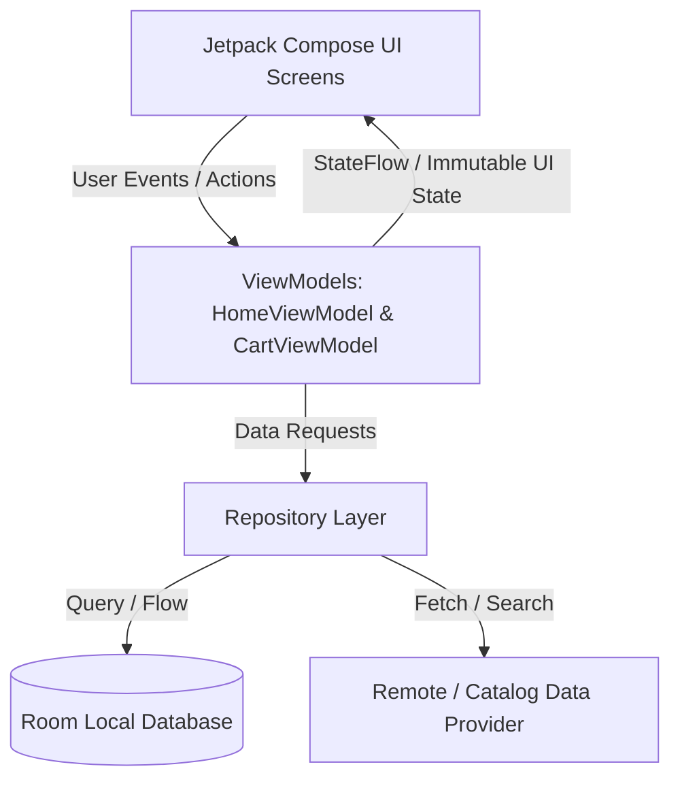

# ⚡ QuickBlink — Native Quick-Commerce Android App
> **Inspired by Swiggy Instamart's 10-Minute Hyperlocal Grocery Delivery Engine**

[](https://kotlinlang.org/)
[](https://developer.android.com/jetpack/compose)
[](https://m3.material.io/)
[](https://developer.android.com/topic/architecture)
[-1BA672?style=for-the-badge)](https://developer.android.com/training/data-storage/room)
[](https://kotlinlang.org/docs/coroutines-overview.html)

---

## 📱 App Overview

**QuickBlink** is a high-performance native Android application engineered specifically around the operational and UI/UX challenges of **Swiggy Instamart**. It delivers a blazing-fast, reactive grocery shopping experience designed to handle instantaneous search, cart mutations, micro-animations, and offline persistence.

---

## 🚀 Key Features & Engineering Highlights

### ⚡ 1. Hyperlocal Delivery Header & ETA Banner
- Real-time delivery ETA badge (**"DELIVERY IN 11 MINS"**) mimicking Instamart dark-store proximity algorithms.
- Interactive location selector with dropdown for multi-address routing.

### 🔍 2. Instant Reactive Search with Debouncing
- Real-time search across hundreds of grocery SKUs, filtering by name, category, and nutritional metadata.
- Optimized query matching powered by Kotlin `StateFlow` to eliminate UI stuttering.

### 🛍️ 3. 2-Column Product Grid & Interactive Micro-Animations
- **Adaptive Quantity Stepper**: Seamlessly transforms from a standard `ADD` button into a `[- 1 +]` counter with smooth Compose animated transitions.
- Veg/Non-Veg indicators, dynamic discount ribbons (e.g., `24% OFF`), and product volume badges (`500 ml`, `1 kg`).

### 🛒 4. Swiggy-Signature Floating Cart Pill
- Slide-up bottom pill triggered automatically whenever cart items exist (`X ITEMS • ₹XXX | View Cart ->`).
- Live calculation of total price and total savings.

### 📋 5. Modal Cart BottomSheet & Dynamic Financial Bill
- **Free Delivery Progress Indicator**: Visual bar encouraging basket size increment (`Add ₹45 more for FREE Delivery`).
- **Delivery Partner Tip Selection**: Custom interactive tip chips (`₹10`, `₹20`, `₹30`, `₹50`) directly credited to the rider.
- **Itemized Bill Breakdown**: Transparent breakdown of Item Total, Handling Charges, Delivery Partner Fee, and Tip.
- **Slide to Place Order**: Interactive checkout action.

### 📍 6. Real-time Live Order Tracking Screen
- Live animated order status step indicator:
  1. *Order Confirmed*
  2. *Packing at Dark Store*
  3. *Delivery Partner On The Way*
  4. *Delivered to Doorstep*
- Delivery Partner Profile Card with rider name, 4.9★ rating, electric scooter vehicle info, and quick call action.

### 💾 7. Offline-First Resilience (Room Database)
- Full local SQLite persistence using Room. Cart items and user states survive app termination, background kills, and low-connectivity environments.

---

## 🏗️ Architecture: MVVM & Unidirectional Data Flow (UDF)



### Clean Architecture Layers:
- **`data/model`**: Domain data models (`Product`, `Category`, `CartItem`, `Order`).
- **`data/local`**: Room `CartDao` and `AppDatabase` providing reactive `Flow<List<CartItem>>`.
- **`data/repository`**: Single Source of Truth handling data transformation, delivery fee calculation, and cart persistence.
- **`ui/viewmodel`**: `HomeViewModel` and `CartViewModel` exposing UI states through Kotlin `StateFlow`.
- **`ui/components`**: Modular, atomic Jetpack Compose components.
- **`ui/screens`**: Complete user flows (`HomeScreen`, `CartBottomSheet`, `OrderTrackingScreen`).

---

## 🛠️ Tech Stack & Dependencies

| Library / Tool | Purpose |
| :--- | :--- |
| **Kotlin** | First-class, modern, concise, null-safe Android language |
| **Jetpack Compose** | Modern declarative UI toolkit (No XML overhead) |
| **Material 3** | Latest design tokens, elevations, and dynamic theming |
| **Room Database** | Type-safe SQLite abstraction for offline cart persistence |
| **Kotlin Coroutines & Flow** | Asynchronous programming & reactive state streams |
| **Coil Compose** | Lightweight, coroutine-based async image loader |
| **Navigation Compose** | In-app screen routing and ModalBottomSheet state management |

---

## 🏁 Getting Started

### Prerequisites:
- Android Studio Hedgehog (2023.1.1) or newer
- JDK 17
- Android SDK 34 (UpsideDownCake)

### Build & Run:
1. Clone the repository:
   ```bash
   git clone https://github.com/Shivampal157/QuickBlink.git
   ```
2. Open the project in **Android Studio**.
3. Let Gradle sync dependencies.
4. Select an Android Emulator (API 26+) or a physical device.
5. Click **Run ('app')** (Shift + F10).

---

## 👤 Author & Candidate Details
- **Role Applied:** Android & iOS Intern — Swiggy Instamart
- **Platform:** Native Android (Kotlin + Jetpack Compose)
